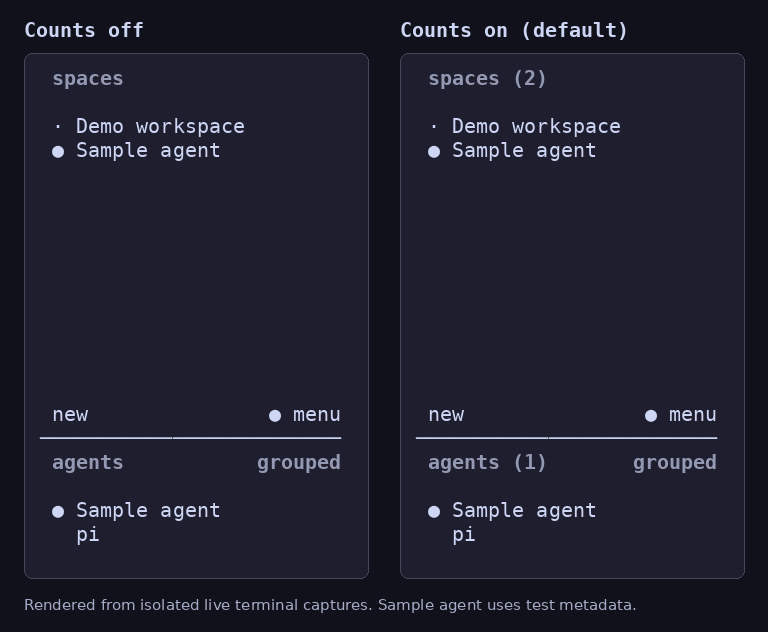

# Live counts in Spaces and Agents headings

A small HERDR fork feature by [David Lepold (@dlepold)](https://github.com/dlepold): see how many Spaces and agents are in your session at a glance.

The expanded sidebar shows `spaces (5)` and `agents (14)`. Both counts are on by default and update when the session changes. They do not depend on how many rows fit on screen.



Spaces include members of collapsed worktree groups. The agent count follows the current list and any active agent-view filter, including the combined list across machines. In a narrow sidebar, the heading keeps its space and the sort/view label uses the remaining columns.

## Configuration

No configuration is needed to turn the counts on. To hide one or both counts, add `show_count = false` to the corresponding existing section of your HERDR `config.toml`:

```toml
[ui.sidebar.spaces]
show_count = false

[ui.sidebar.agents]
show_count = false
```

Each option is independent. Reload the client config with the default `Ctrl+B`, then `Shift+R` binding after changing it. A client running an older binary needs to be detached and started with the fork binary first.

## Try the fork

This is a community fork build. The feature is not part of an upstream HERDR release.

Building requires the Rust toolchain pinned in `rust-toolchain.toml` and [Zig 0.16.0](https://ziglang.org/download/). If Zig is not on `PATH`, set `ZIG` to its executable path.

```sh
git clone --depth 1 --branch community/sidebar-counts --single-branch https://github.com/dlepold/herdr.git
cd herdr
cargo build --release --locked
./target/release/herdr --session sidebar-counts-demo
```

The example uses a separate named session and runs the binary directly. See the [upstream documentation](https://herdr.dev/docs) for normal HERDR configuration and session management.

## Validation

Base: upstream `master` at `2713feb56e9c9db33992db0a262c68f7426d46dd` (package version 0.9.5).

Validated on Linux x86_64:

- Native `just ci` stages: formatting, Clippy with warnings denied, all 4,133 Rust tests (17 existing tests skipped), maintenance checks, UI architecture checks, and integration asset tests passed.
- `just docs-contract-test`: 7 tests passed.
- `just check` reached the Windows cross-check after the native stages, then stopped because this machine has no Windows SDK configuration. Windows compilation and runtime behavior have not been verified here.
- Optimized build and live smoke test passed: default counts, adding/removing a Space and a synthetic agent, disabling/re-enabling counts through client config reload, and demo captures with identical list contents.

The smoke test uses its own temporary configuration, named HERDR session and tmux server. It checks default counts, additions, removals, and switching the counts off and on through live config reload. Its sample agent is a synthetic metadata report; no coding agent is launched. The comparison image is rendered from those test terminal captures.

To repeat the smoke test after building (Python 3 and tmux required):

```sh
python3 docs/next/sidebar-counts/smoke-test.py
```

Set `HERDR_COUNTS_TEST_BIN` to test a different binary and `HERDR_COUNTS_ARTIFACTS` to keep the captured terminal frames in a specific directory.

## Related

I also maintain [Agent Resource Badges](https://github.com/dlepold/herdr-agent-resource-badges), which adds CPU/RAM badges per agent. Working with many open agents prompted this small sidebar improvement. The counts are implemented in HERDR's client because the plugin metadata API addresses entry rows rather than panel headings.

HERDR remains the work of its upstream authors. The fork retains its Apache-2.0 license and attribution.
